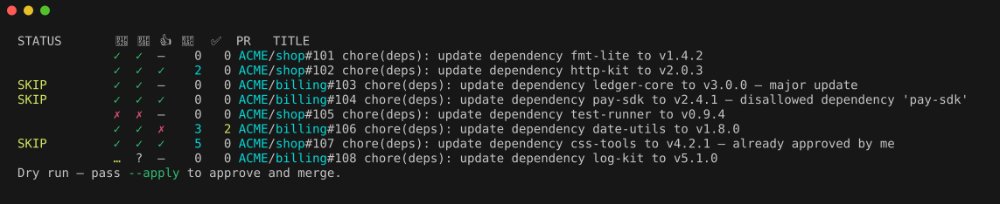

# bbapprove

Approve and merge the safe Renovate pull requests on Bitbucket Server from the terminal.



It lists the PRs where you are a reviewer and marks which are safe to take (minor, patch and digest updates by
your bot). `bbapprove --apply` approves and merges them; without `--apply` nothing changes. `-i` opens the TUI shown above.



Try it without a server: `bin/demo run`. The images use fictional PRs; `bin/demo regenerate` refreshes them.

## Install

From a release archive (`bbapprove-<tag>-<os>-<arch>.tar.gz` plus `SHA256SUMS` on the GitHub Releases page).
Verify, extract somewhere permanent and link the launcher onto `PATH`:

```
shasum -a 256 -c SHA256SUMS --ignore-missing
tar -xzf bbapprove-v1.0.0-darwin-arm64.tar.gz -C ~/.local/share
ln -s ~/.local/share/bbapprove-v1.0.0-darwin-arm64/bin/bbapprove ~/.local/bin/bbapprove
```

Keep the tree intact: the binary finds `adapters/` relative to its own directory.

From a clone (needs Go, see `go.mod`): `bin/build --install` builds and links `bin/bbapprove` into `~/.local/bin`.
`bbapprove --version` prints the version. Maintainers: [docs/development.md](docs/development.md).

## Set up

```
bbapprove --init                 # writes ~/.config/bbapprove/config.toml (Windows: %AppData%\bbapprove\config.toml) from the template; edit repository and author_email
export BBAPPROVE_TOKEN=...       # a Bitbucket HTTP access token; or name a 1Password item with --token-name
bbapprove doctor                 # checks the result
```

Without a config file, a run on a terminal offers the same `--init` step. Details: `bbapprove help config`
(lookup, precedence, `--print-config`) and `bbapprove help token`. For Bitbucket the adapter is built into the
binary, so nothing else has to be installed to talk to the server (bash, curl and jq are not needed).

## First run

```
bbapprove                        # dry run: every open PR where you are a reviewer; blank STATUS = eligible
bbapprove --apply                # approve, then merge, the eligible ones
bbapprove --apply PR_URL...      # only these PRs
```

Eligibility, the ignore list and the STATUS words: `bbapprove help rules`.

**Try it without a server:** `bin/demo run` opens the TUI on fictional PRs (`bin/demo list` prints the list). Start over with `rm -f "${TMPDIR:-/tmp}/bbapprove-demo-state"`.

## Using the TUI

`bbapprove -i` lists the same PRs with live status and stays open after every action. **Lowercase keys act on the
row under the cursor and never touch marks; uppercase keys act on the marked rows.** Actions run in the background; a
busy row answers "row busy". `?` shows the keys in the TUI.

| Key | Action |
| --- | --- |
| `↑`/`↓`, `j`/`k` | move |
| `a` | approve + merge the cursor row at once (refused when not eligible) |
| `d` | decline the cursor row (y/N confirm, then optional comment) |
| `c` | comment on the cursor row (empty comment refused) |
| `i` | ignore the row's dependency; on an ignored row, un-ignore it |
| `o` | open the PR in the browser |
| `x` / space | mark / unmark the cursor row |
| `ctrl+a` | mark all eligible rows |
| `u` / ctrl+d | clear marks |
| `A` | approve + merge the marked eligible rows (confirm; others skipped, with a count) |
| `D` | decline the marked rows (confirm, then one shared optional comment) |
| `C` | comment on the marked rows (one shared comment, empty refused) |
| `r` | reload (cursor and marks are kept by PR URL; row statuses reset) |
| `.` / `h` | show/hide ignored rows |
| `?` | toggle the extended help |
| `q` | quit and print a summary of the session |

With no marked rows `A`/`D`/`C` only show "no marked rows"; after a batch action the acted rows are un-marked.
Columns, status bar, exit summary and mouse: `bbapprove help tui`.

## Update

```
bbapprove --outdated             # read-only check: exit 0 up to date, 1 outdated, 2 could not check
bbapprove --update               # shows a plan, then asks Proceed? [y/N]
```

bbapprove never checks by itself. How a checkout and a release archive are updated, and what the checksum does and
does not protect: `bbapprove help update`.

## Troubleshooting

`bbapprove doctor` is a read-only report (no token or forge access needed): installation, config in use, where
each setting came from, token source, ignore list, tools, one line each; `bbapprove doctor -v` prints the full
report. `bbapprove help doctor` explains each section. A row
shown as IGNORED is on your ignore file, which doctor lists. Environment variables and exit codes:
`bbapprove help env`.

## More

`bbapprove --help` is the reference for flags. Topics: `bbapprove help rules`, `bbapprove help tui`, `bbapprove help config`,
`bbapprove help token`, `bbapprove help update`, `bbapprove help env`, `bbapprove help doctor`.
Contributors: [AGENTS.md](AGENTS.md) and [docs/](docs/README.md). Open work: [TODO.md](TODO.md). Changes: [CHANGELOG.md](CHANGELOG.md).

## License

MIT, see [LICENSE](LICENSE).
